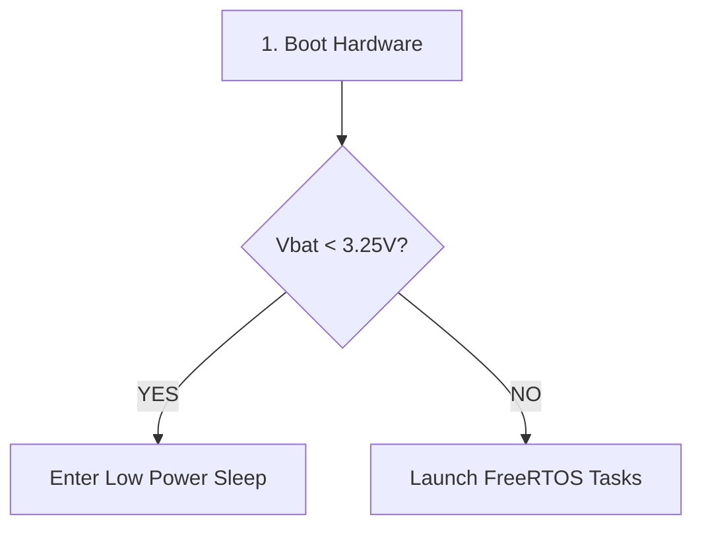
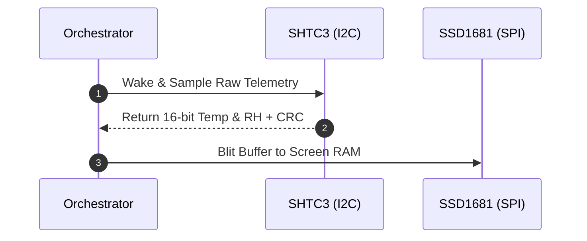

# GitHub Flavored Markdown (GFM) Specification & Authoring Guide

This skill governs the authoring, formatting, and structural validation of documentation across the repository. It enforces strict compliance with the GitHub Flavored Markdown (GFM) specification, CommonMark, MathJax rendering engine rules, and GitHub's Mermaid diagram parser.

---

## 0. Scope & Exemption Boundary

To prevent layout distortion and maintain tool fluidity, documentation is partitioned into two distinct categories:

1. **In-Scope (Strict GFM & MathJax Compliance Mandatory):**
   - All official, public-facing repository documentation:
     - Root documents: `README.md`, `ERRATA.md`, `CHANGELOG.md`
     - Architecture specifications: `docs/architecture/*.md`
     - Driver manuals: `docs/drivers/*.md`
     - System reference guides: `docs/pinout.md`, `docs/guide.md`, `docs/history.md`, `docs/api.md`

2. **Out-of-Scope (Exempt from Strict GFM Syntax):**
   - Internal agent scratch notes, working logs, planning artifacts, and telemetry dumps:
     - `docs/agent_notes/`
     - `docs/logs/`
     - Agent conversation artifacts (`<appDataDir>/brain/<conversation-id>/...`)
   - *Rationale:* Internal working documents frequently utilize custom HTML line-breaks (`<br>`), multi-line cell layouts, and raw diagnostic dumps that render awkwardly or distort formatting when forced into strict GFM syntax. Internal files are not required to follow the strict GFM parser constraints.

## 1. LaTeX Mathematical Expressions (MathJax)

GitHub parses mathematical expressions using MathJax. Syntax errors cause equations to render as raw broken text.

### 1.1 Block / Display Math (`$$`)
Block equations **must** be written as dedicated multi-line blocks isolated by blank lines above and below.

#### Required Format:
```markdown
Text preceding the equation.

$$
RH = \frac{e}{e_s(T)} \times 100\%
$$

Text proceeding the equation.
```

#### Formatting Invariants:
1. **Never write single-line display math:** `$$formula$$` is brittle across differing GitHub renderers.
2. **Surround with empty newlines:** There **must** be a blank newline before the opening `$$` and after the closing `$$`.
3. **Never indent `$$` blocks (Column 0 Rule):** Even when placing block equations after bulleted or numbered list items, the opening `$$`, equation content, and closing `$$` **must start at column 0 (no leading spaces)** with blank lines above and below. Indented `  $$` inside lists fails to parse as display math in GitHub's `cmark-gfm` engine and collapses onto a single plain-text line.

```markdown
- **Vapor Pressure ($e$):**

$$
e = \frac{RH}{100} \cdot e_s(T) \quad [\text{hPa}]
$$

- **True Dew Point ($T_{\text{dew}}$):**
```

### 1.2 Inline Math (`$...$`)
Inline math renders formulas within a sentence.

#### Required Format:
```markdown
The sensor completes sampling in $<10\text{ ms}$ with quiescent leakage $\le 15\ \mu\text{A}$.
```

#### Formatting Invariants:
1. **No Interior Whitespace:** The opening `$` must NOT be followed immediately by a space, and the closing `$` must NOT be preceded by a space.
   - ✅ Correct: `$x$` or `$T_{\text{dew}} = 12.5^\circ\text{C}$`
   - ❌ Invalid: `$ x $` or `$ T_{\text{dew}} $` (Breaks MathJax rendering)
2. **Escaping Literal Dollar Signs:** To display literal currency or shell symbols, escape with `\$` or wrap in backticks (`$HOME`).
3. **Units in Math:** Use `\text{...}` for engineering units, e.g., `$\mu\text{A}$`, `\text{mV}`, `\text{hPa}`, `\Omega`.
4. **Never Use `\_` Inside `\text{...}` or Math Mode:** GitHub's Markdown preprocessor strips the backslash from `\_` before MathJax parses the formula, leaving a raw `_` inside text mode and throwing `'_' allowed only in math mode`. Always use single-word subscripts (`T_{\text{floor}}`), hyphens (`T_{\text{amb-floor}}`), or parentheses (`V_{\text{bat(mV)}}`).

---

## 2. Mermaid Diagrams

Diagrams render automatically inside fenced code blocks tagged with `mermaid`. GitHub's Mermaid sandbox lexer and DOM sanitizer are strictly sensitive to HTML tags, special characters, and punctuation.

### 2.1 Subgraphs, Node Identifiers, & Label Sanitization
1. **Use Canonical `graph TD;` / `graph LR;` with Semicolons:** Prefer `graph TD;` or `graph LR;` with semicolons (`;`) terminating every node, edge, and `end;` statement. Avoid `stateDiagram-v2` when transition labels contain parentheses `(HIGH)` or arrows `->`, as these trigger parser errors on GitHub.
2. **Valid Alphanumeric Subgraph IDs:** Always declare subgraphs with a clean alphanumeric ID and put the human-readable title inside square brackets with quotes:
   - ✅ Correct: `subgraph Power_Rails ["Power Distribution Rails"]`
   - ❌ Invalid: `subgraph "Power Distribution Rails"`
3. **No Reserved Keyword Collisions:** Do not name nodes or subgraphs using Mermaid keywords (`end`, `subgraph`, `graph`, `style`, `click`) or duplicate an identifier between a node and a subgraph.
4. **Always Quote Node & Edge Labels:** Wrap all node labels in double quotes (`NODE["Label"]`, `DECISION{"Condition?"}`) and edge labels in `-- "Label" -->`.
5. **No HTML, Ampersands, Nested Brackets, or Unicode in Labels:** Never use `<br/>`, raw `&`, nested `[...]`, bullet characters (`•`), or non-ASCII Unicode (`Ω`, `µ`, `–`) inside Mermaid labels. Use plain ASCII equivalents (` - `, `and`, `(...)`, `uA`, `Ohm`).

### 2.2 Standard Mermaid Skeleton Examples

#### Flowchart (`graph TD;`)


#### Sequence Diagram (`sequenceDiagram`)


---

## 3. Alerts (Callouts)

Alerts render styled admonition blockquotes with icons and colors.

```markdown
> [!NOTE]
> Highlights useful information or passive contextual notes.

> [!TIP]
> Helpful advice, optimizations, or shortcuts.

> [!IMPORTANT]
> Key information required to proceed or avoid common pitfalls.

> [!WARNING]
> Urgent info advising against risky behavior or broken states.

> [!CAUTION]
> Negative consequences of an action, such as data loss or irreversible commands.
```

### Formatting Invariants:
1. The opening line must strictly start with `> [!TYPE]` with **no spaces before the `>`** and exactly one space before `[!`.
2. Subsequent lines in the callout must begin with `> `.

---

## 4. Tables & Alignment

Tables require header dividers using pipes `|` and hyphens `-`. Colons indicate column alignment:

```markdown
| Peripheral | Bus / Protocol | Pin / Address | Mode / Clock |
| :--------- | :------------: | ------------: | ------------ |
| SSD1681    | SPI2 Master    |       GPIO 10 | 20 MHz       |
| SHTC3      | I2C0           |          0x70 | 400 kHz      |
| PCF85063A  | I2C0           |          0x51 | 400 kHz      |
```

- `:---` left aligns.
- `:---:` center aligns.
- `---:` right aligns.

---

## 5. Collapsible HTML Blocks (`<details>`)

When embedding collapsible blocks, standard HTML `<details>` and `<summary>` tags must be followed by a blank line before Markdown parsing can occur:

```markdown
<details>
<summary>Click to expand technical register table</summary>

A blank line **must** follow the `</summary>` tag for internal markdown to parse.

| Register | Address | Default |
|---|---|---|
| `CTRL_1` | `0x00`  | `0x00`  |

</details>
```

---

## 6. Pre-Commit Verification Checklist

Whenever editing or adding Markdown files, verify:
- [ ] No single-line `$$formula$$` block equations exist; all display math blocks are multi-line with blank line padding.
- [ ] No `$ formula $` exists with interior space adjacent to `$`.
- [ ] All Mermaid subgraphs have explicit alphanumeric IDs: `subgraph ID ["Label"]`.
- [ ] All Mermaid node labels with special characters are wrapped in double quotes `["..."]`.
- [ ] All callouts use canonical `> [!TYPE]` headers.
- [ ] Blank lines exist after all closing `</summary>` or `</div>` tags before Markdown resumes.
